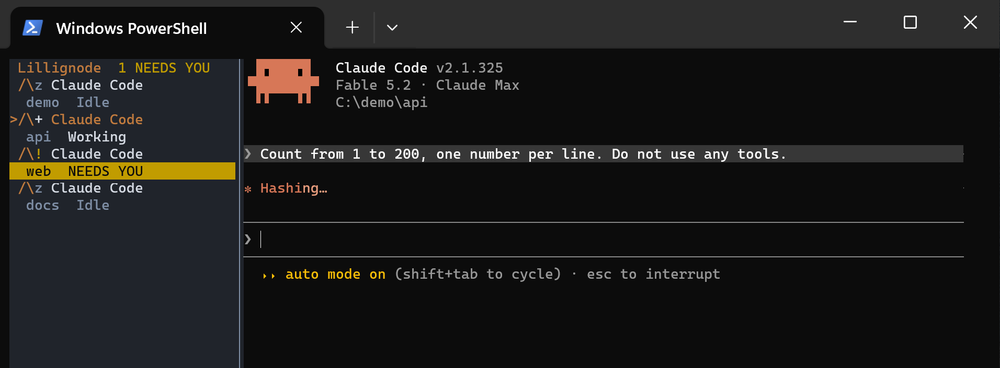

# Lillignode

Lillignode runs several AI coding agents at once in one terminal window. Each agent works in its own folder and has its own screen; a sidebar lists them all and says what each one is doing, and you hop between them with a key. Two can share the screen when you want to watch both.

The name is said "Lilli-node": the g is silent, as in gnome.



**Status: v0.1, rough.** Built and tested on Windows 11. It builds and its unit tests pass on Linux; nobody has run an agent in it there, and macOS is untested. Expect sharp edges.

## What v0.1 does

- **Several Claude Code agents in one window.** Each has its own folder and its own screen. One agent is in front and takes your typing; the sidebar lists the rest.
- **Hop between them.** Press the menu key (Ctrl+Q or F12), then Tab.
- **See what each one is doing.** The sidebar shows Starting, Working, Needs you, Done, Idle or Error, as the agent itself reports it. Claude Code and Codex CLI report; so can any other program (see [Status](#status)). When Lillignode cannot tell, it says Unknown. It never guesses.
- **Two side by side, when you want.** Menu key, then `v`: the agent in front on the left, the next one beside it, each half the width. `v` again goes back to one. See [Two side by side](#two-side-by-side).
- **Come back to where you were.** Quit and start again: the same agents reopen in the same folders, and Claude Code continues each conversation. Any other agent, Codex included, is started again and begins a new conversation; Lillignode says which.
- **Read back what scrolled away.** The last 5,000 lines per agent, with Shift+PgUp.
- **Paste safely.** A multi-line paste reaches the agent as one paste, never as a string of Enter presses.
- **Run any other command-line agent too.** If it reports its status in the open format, the sidebar shows it. If it does not, it runs all the same and its status shows Unknown.
- **Cost, if you switch it on.** Experimental and off by default. See [Cost](#cost-experimental-off-by-default).

## The look

Each agent in the sidebar has two lines: a gnome mark and its name, then its folder and its status. The mark is a copper hat `/\` over one sign, so the sidebar can be read at a glance and without colour:

| Sign | Status |
|---|---|
| `+` and `*`, turning about once a second | Working |
| `+` held still | Working, but nothing drawn for a minute or more ("Working, quiet 2 min") |
| `!` | Needs you |
| `=` | Done |
| `z` | Idle |
| `x` | Error, or stopped with an error |
| `?` | Unknown |
| `.` | Starting |
| `-` | Exited |

The sidebar says the status in a word or two: "NEEDS YOU", "Unknown", "Error". Why (permission or a question, why status is unknown, the error's own words) is in the notice under the agent and in the status report (menu key, then `s`).

**Yellow means Needs you and nothing else.** An agent waiting for you gets a yellow block in the sidebar, a count beside the name at the top, a notice naming it, and one bell. Copper marks the hats, the name at the top and the agent in front, which also has a `>` before its hat.

Lillignode works out how many colours your terminal shows and uses fewer where it has to. With 16 colours or none, the hats and the agent in front are bold instead of copper; the characters are the same at every depth. Lillignode never colours an agent's own screen.

The bottom line always starts with the menu keys. After them it says where your typing goes.

## Get it (Windows)

1. Download `lillignode-0.1.0-windows-x64.zip` from the [latest release](https://github.com/kuma-djt/lillignode/releases/latest). The release page lists the zip's SHA-256, so you can check the download (`Get-FileHash lillignode-0.1.0-windows-x64.zip` in PowerShell).
2. Unzip it anywhere. It unpacks into one folder.
3. Open Windows Terminal in that folder and run `.\lillignode.exe`.
4. Press `n` to start an agent: Enter for Claude Code, then type the folder it should work in and press Enter. (Enter alone uses the folder Lillignode was started in.)

You need [Claude Code](https://claude.com/claude-code) installed and signed in. The program is not signed, so Windows may warn you the first time you run it.

## Using it

**On Windows, use Windows Terminal.** In the classic console window, pasting into Claude Code does not work (with or without Lillignode). In VS Code's terminal Ctrl+Q belongs to VS Code, so use F12.

Inside Lillignode, press `n` to start an agent: Enter for Claude Code, then the folder it should work in. Your typing goes to the agent in front. Ctrl+Q or F12 opens Lillignode's menu:

| Key | What it does |
|---|---|
| Esc | back to the agent |
| q | quit |
| Tab, Shift+Tab | next agent, previous agent |
| n | new agent |
| x | close the agent in front |
| r | start it again after it has stopped |
| s | its status report (and its cost, if switched on) |
| PgUp | read back its history |
| v | two agents side by side, or back to one |

```
lillignode --where     where your workspace and settings are kept
lillignode --help
lillignode --version
```

## Build from source

You need the [Rust toolchain](https://rustup.rs) and, to do anything useful, [Claude Code](https://claude.com/claude-code) installed and signed in.

```
git clone https://github.com/kuma-djt/lillignode
cd lillignode
cargo build --release
target\release\lillignode.exe
```

On macOS or Linux the last line is `target/release/lillignode`, and you are in untested territory.

### On Windows, one extra step for status

Claude Code reports its status only after its terminal answers a question, and on Windows that answer only reaches it through Microsoft's newer pseudo-terminal, two files (`conpty.dll` and `OpenConsole.exe`) that must sit beside `lillignode.exe`. The release zip has them; a build from source does not. Without them agents run normally, and an agent that waits for the answer, as Claude Code does, shows Unknown. An agent that reports without asking, as Codex does, is not affected. This script downloads them from Microsoft's Windows Terminal release, checks their hashes and Microsoft's signature, and puts them in place:

```
powershell -ExecutionPolicy Bypass -File scripts\package-windows.ps1 -BesideBuild
```

Without `-BesideBuild` it builds a release folder and a zip in `dist\`. See [docs/packaging-windows.md](docs/packaging-windows.md).

## Two side by side

Menu key, then `v`. The agent in front goes on the left with the next agent beside it, and each gets a heading. The one typing goes to says TYPING GOES HERE on a copper block; the other says "not typing here". `v` again goes back to one. The view is not remembered when you quit.

- **Typing goes to one agent only,** the one whose heading says TYPING GOES HERE. The bottom line says which side. While the menu or a question is open, or the agent in front has stopped, the heading says so instead: keys are Lillignode's then.
- **Tab (after the menu key) goes to the next agent in the sidebar's order,** as it does with one on screen. If that agent is already on screen, the keyboard moves to it. If not, it takes the side you are on and the other side stays put. With more than two agents open, Tab is not always "the other side".
- **An agent that needs you while you are typing into the other one** gets a yellow heading: "NEEDS YOU - you are NOT typing here". Read it before you answer: what you type goes to the other agent until you switch.
- **It needs a window at least 109 columns wide.** In a narrower one `v` is refused and says so. If you narrow the window while two are showing, Lillignode shows one, says why, and puts both back when there is room.
- **Changing the view resizes every agent,** shown or not, and each redraws at its new size. While Lillignode knows an agent is waiting for you, it asks first. It cannot know that for an agent whose status is Unknown (any agent that is not reporting): those are resized without a question.
- **What a narrower size costs.** Anything on an agent's screen beyond the new width is gone until the agent draws it again. Lines already in its history are kept whole.

Checked by hand with Claude Code 2.1.325: both agents redraw cleanly at half width, and on November 16, 2026, in Windows Terminal, a resize while Claude Code was showing a permission prompt left the prompt whole and answerable. If an agent looks wrong after a change, `v` goes back to one; most agents also redraw on Ctrl+L.

## Cost (experimental, off by default)

Put `"cost": true` in the settings file and Lillignode shows, under each Claude Code agent, how many tokens its conversation has used, with a total for all agents at the foot of the sidebar and a breakdown one key away (menu key, then `s`). Everywhere it is shown, it says it is experimental.

**What it reads.** Claude Code keeps a record of each conversation in its own folder on this machine. Lillignode opens the record of each conversation it started, read-only, takes the token counts and the model name from each reply, and keeps nothing else. It changes nothing, saves nothing, and sends nothing anywhere. While cost is off, it reads none of these records.

**Why it is experimental.** The record's format is internal to Claude Code and not documented; an update to Claude Code can change it. Lillignode reads it exactly or not at all: before anything is read it says "cost pending", and when it cannot read or understand a record it says "cost unknown". It never shows a zero it has not read. It has been seen reading real records and showing counts, but its figures have not yet been compared with Claude Code's own `/usage`. Trust `/usage`.

**Why a new conversation starts high.** A conversation's first request counts tens of thousands of tokens (about 59,000 in one check), most of them Claude Code writing its own instructions to its cache. That is real use, so it is counted, not hidden. It also means a cost warning set below that is passed by every agent at once: set it well above it.

- **The count in the sidebar leaves out tokens read from cache.** They are most of a long conversation's count and the cheapest part of it. The breakdown shows them apart.
- **The breakdown also says what was used since Lillignode was started,** for the agent in front and for all agents open now.
- **A warning, if you want one.** Add `"cost_warning_tokens": 500000` (any count above zero) and a conversation that reaches it gets PAST WARNING in bold beside its figure, and one notice. That is all it does: nothing is stopped, held, or asked. The warning is for each conversation by itself, not for all of them added up, and it is given again each time Lillignode is started while the conversation is past it.
- **Dollars** are an estimate from a price list built into the program, shown in the sidebar only if you put `"billing": "key"` in the settings file. Unlike the token count, the estimate includes cache reads, because they are billed. Plan limits are not shown.

## Settings

One JSON file; `lillignode --where` says where it is.

```json
{ "menu_keys": ["ctrl+q", "f12"], "bell": true }
```

Those two are the defaults. The settings for cost, which is off unless you ask:

```json
{ "cost": true, "cost_warning_tokens": 500000, "billing": "key" }
```

If the colours come out wrong, add `"colors"` with `"full"`, `"256"`, `"16"` or `"none"`. Setting the `NO_COLOR` environment variable also switches colour off.

All are optional, and a change takes effect the next time Lillignode is started. `billing` does nothing without `cost`, and `cost_warning_tokens` without it is reported as a mistake.

**The file is strict.** One mistake in it and none of it is used: every setting is at its default until it is fixed. Lillignode never changes the file. It tells you when it starts, beginning with how to fix it ("To fix your settings file: ...") and naming the line and column where it can.

## Status

An agent's status is what the agent says it is. Lillignode reads the status reports a program sends to its terminal in an open format, the [Program Status proposal (OSC 7501)](https://mitchellh.com/writing/program-status-osc7501) by Mitchell Hashimoto ([specification](https://www.superlogical.com/rex/docs/build/program-status), read here as revision 0.4). Any program may send them, and the report's own name for its sender says who it is. The status report (menu key, then `s`) shows the last report as it arrived, how it was read, and who sent it.

- **Any program that reports gets a status,** with the yellow block and the bell when it needs you. Lillignode's terminal answers "yes" to a program that asks whether reports are taken.
- **A program that reports nothing shows Unknown,** and the status report says no report has come. Claude Code and Codex are expected to report, so for them a notice says so once, with the likeliest cause.
- **Checked with** Claude Code 2.1.325 and Codex 0.169.0, on Windows 11. Any other program's reports are read the same way and have not been checked by anyone.
- **Done means its turn ended,** not that the work succeeded.

What Lillignode does with a report that is not as expected:

- **A state it does not know** shows "Unknown", never the status before it.
- **A part it does not know is passed over,** as the format asks. A reason for waiting that it does not know still shows Needs you.
- **A message is shown as plain words.** Characters that would draw, move, hide or reorder text become spaces, and a long message is cut.
- **A program that changes status very fast** rings at most three bells in a row, then one every 20 seconds. Its row still shows its latest status.
- **A report about one part of a program** (the format lets a program report several) is counted but not shown: the row is the program's own status. A program whose only waiting record is a part does not show Needs you.
- **Inside a shell,** Working or Needs you ends when the shell marks its next prompt (shells with prompt marking switched on). Without that, a program that died while Working stays "Working, quiet N min".

What to watch for:

- **Anything that prints a status report into an agent's terminal is read as that agent's status,** for example a file holding those bytes shown raw in a shell. A false Idle could hide a real Needs you.
- **The format is a draft** and can change. A report this Lillignode cannot read shows Unknown.

## Codex

Start Codex CLI like any agent: press `n`, type `codex`, then the folder. A program whose file is named `codex` is taken for Codex. Lillignode adds nothing to how Codex is started and changes none of its settings.

**Checked by script, not yet by a person in a real window.** With Codex 0.169.0 on Windows 11, inside Lillignode: Starting, Idle, Working, Needs you with one bell at an approval, Done, and Unknown when signed out. Not seen from real Codex: an error, a question, Esc in the middle of a turn. That check was made before status was opened to every program and has not been repeated since.

What Codex gets, and what it does not:

- **Status, the yellow block and the bell:** yes, as for any program that reports.
- **On Windows, the two Microsoft files are not needed for Codex's status.** Codex reports without waiting for an answer.
- **Its conversation is not continued.** When Lillignode reopens a Codex agent, or you start one again, it begins a new conversation. Codex's own `codex resume` still finds the earlier one.
- **No cost.** It shows "cost unknown", never zero.

What to watch for:

- **Codex says Idle on at least one of its own set-up screens that is waiting for you.** Seen with Codex 0.169.0 at its first-run sandbox question; there may be others. Lillignode shows Idle there, with no yellow block and no bell, because that is what Codex reported. A request for permission while it was working was seen to be reported as it should be.
- **Whether Codex asks permission depends on how it is started and set up.** Started plainly it may never ask: a blocked command ends its turn, and the row says Done.
- **Signed out, Codex reports nothing** (seen with 0.169.0). Its row shows Unknown after 15 seconds, and a notice says so. The same notice appears if Codex is silent for any other reason.
- **History.** Codex draws on a full-screen display, which leaves Lillignode no history to keep. Scroll with Codex's own keys.

## Known limits in 0.1

These are known and not yet fixed. Please do not report them as security problems.

- **The saved workspace is trusted at launch.** When Lillignode starts, it runs the agents listed in its workspace file as they are written there: the command, its arguments, its folder and its conversation id. Anyone who can change that file can make Lillignode start a program the next time you open it. The file is in your own user folder (`lillignode --where` says where); keep it there and do not point `LILLIGNODE_STATE_DIR` at a shared folder.
- **Pasted text keeps control characters.** Lillignode removes the escape character from a paste, so a paste cannot end itself early, but other control characters, such as Ctrl+C or Ctrl+D, reach the agent as they are. Paste only what you meant to type.
- **Cost is experimental.** Its figures have not been compared with Claude Code's own `/usage`. Trust `/usage`.
- **Only Windows has been run by a person.** Linux builds and passes the unit tests and the lint in CI. macOS is not built or tested at all. Nobody has started an agent in Lillignode on either. If you test it on one and it works, thanks. Please let me know.

## Other limits

- **Windows 11 only so far.** Use Windows Terminal (see above).
- **Claude Code is the one agent with cost and a conversation that continues.** Status is for any program that reports it; see [Status](#status).
- **Codex has status only.** See [Codex](#codex) for what that leaves out and what to watch for.
- **If `CLAUDE_CODE_DISABLE_TERMINAL_TITLE` is set where you start Lillignode,** Claude Code does not report status and every Claude Code agent shows Unknown. Lillignode leaves your setting alone.
- **Agents stop when you quit.** They reopen next time. Lillignode asks before quitting only while an agent may be in the middle of something.
- **The sidebar and the status report do not scroll,** the mouse is not passed to agents, history cannot be searched, and an agent cannot be renamed.
- **No installer, and the program is not signed.** On Windows, build it yourself or use the release zip.

## What it touches on your machine

- It does not ask for, read, or store API keys. Each agent uses the account it already has.
- It sends nothing anywhere: no telemetry, no crash reports, no update checks.
- It saves which agents are open, their folders, and their conversation ids. It never saves what an agent printed.
- Only if you switch cost on, it reads Claude Code's own record of each conversation it started, read-only, and keeps only the token counts and the model name.
- It does not change Claude Code's settings.

## Checking your changes

```
cargo build --release --all-targets
cargo test
cargo clippy --all-targets -- -D warnings
cargo fmt --check
cargo run --release --example e2e
```

The last one drives the real program against a stand-in agent and takes about two minutes. On Windows, run the packaging script with `-BesideBuild` first so it covers status. See [CONTRIBUTING.md](CONTRIBUTING.md) before sending a change, including the rule that tests never touch a real Claude Code setup.

## How it is built

Most of Lillignode's code is written by an AI coding agent, Claude Code, directed by a person. Every change passes the five checks above and independent reviews, and each release is checked by hand by a person against real Claude Code. What has not been checked yet is listed under [Known limits in 0.1](#known-limits-in-01).

## Licence

Copyright (C) 2026 Turnbow Analytics LLC.

Lillignode is free software under the [GNU Affero General Public License, version 3](LICENSE). It comes with no warranty.

If the AGPL does not suit your use, Turnbow Analytics LLC may offer a commercial licence. Contributions are accepted under a contributor licence agreement so that this stays possible; see [CONTRIBUTING.md](CONTRIBUTING.md).

The two Microsoft files the Windows packaging script downloads are Microsoft's, under the MIT licence: [packaging/windows/LICENSE-Microsoft-ConPTY.txt](packaging/windows/LICENSE-Microsoft-ConPTY.txt). They are not in this repository. The icon in `assets/` is Lillignode's own, under the same licence as the rest.
